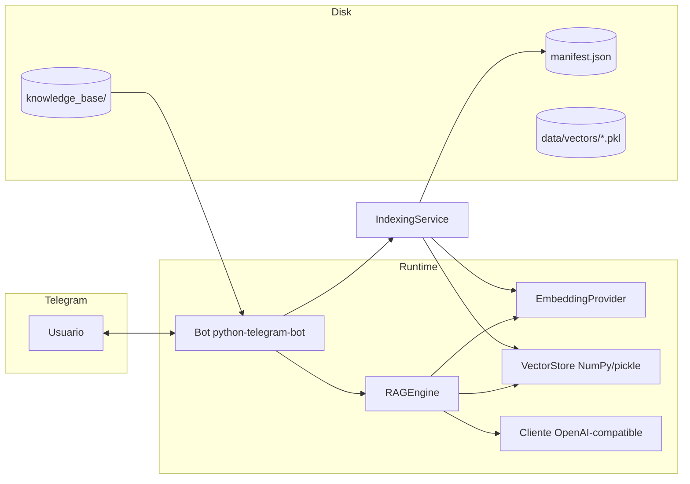

# Arquitectura

Descripción del asistente de mesa de ayuda con RAG en Telegram para la prueba de Bios, alineada a `src/mesa_ayuda_rag/`.

## Diagrama de componentes

## Flujo de ingesta

1. Se listan archivos válidos (`.md`, `.txt`, `.pdf`, `.docx`) bajo `knowledge_base/`.
2. Por archivo se calcula huella (hash de contenido, tamaño, `mtime`) y se compara con `data/manifest.json` (indexación incremental).
3. Si el archivo es nuevo o cambió, se extrae texto, se fragmenta con solapamiento configurable y se generan embeddings.
4. Se persisten vectores y metadatos en `data/vectors/<vector_index_name>.pkl` y se actualiza el manifiesto.

## Flujo de una pregunta (runtime)

1. Telegram entrega el mensaje → el bot valida **ALLOWED_USER_IDS** y **RATE_LIMIT_PER_MINUTE**.
2. Se recupera el **historial** del usuario (acotado por `HISTORY_LENGTH`).
3. Embedding de la pregunta → búsqueda **top-k** → filtro por **SIMILARITY_THRESHOLD**.
4. Sin candidatos útiles: respuesta de “no consta” y registro en `data/unanswered.log`.
5. Con candidatos: bloque de documentos recuperados + historial → **LLM** con `prompts/system_prompt.md`.
6. Respuesta al usuario (con **Fuentes** en el texto o añadidas en código si el modelo las omite) y actualización del historial en memoria.

## Pipeline RAG (implementación explícita)

No uso LangChain ni LlamaIndex: el recorrido está repartido en módulos con una responsabilidad cada uno (decisión **ADR-003** en `docs/DECISIONES.md`). Así el comportamiento exigido por el spec — manifiesto, umbral, corte sin LLM, fuentes y log de preguntas sin respuesta — coincide con funciones concretas del repo.

| Módulo | Responsabilidad |
|--------|-----------------|
| `loaders.py` | Lectura de `.md`, `.txt`, `.pdf`, `.docx` desde `knowledge_base/`. |
| `chunking.py` | Fragmentación y metadatos (`source_path`, índice, sección/página). |
| `embeddings.py` | Proveedor local (`sentence-transformers`) u OpenAI-compatible. |
| `manifest.py` | Huella por archivo para indexación incremental (RF-09). |
| `vector_store.py` | Persistencia NumPy + pickle, búsqueda top-k y distancia (ADR-006). |
| `indexing.py` | Orquesta ingesta: solo archivos nuevos o modificados → embed → upsert. |
| `rag.py` | Embedding de la pregunta, filtro por umbral, armado del mensaje con `prompts/system_prompt.md`, llamada al LLM, `_ensure_sources_footer()`, `unanswered.log` si no hay contexto. |
| `bot.py` | Telegram, acceso, rate limit, historial, comando `/reindex`. |
| `config.py` + `config.yaml` | Parámetros externos (chunks, top-k, umbral, rutas). |

Con un framework de cadenas el mismo resultado sería posible, pero aquí cada RF obligatorio tiene un punto de enganche visible (por ejemplo RF-04 en `rag.py` antes de invocar al cliente LLM).

## Estructura de carpetas

| Ruta | Rol |
|------|-----|
| `src/mesa_ayuda_rag/` | Código del bot, RAG, ingesta e índice |
| `prompts/` | System prompt editable sin tocar código |
| `knowledge_base/` | Documentos que alimentan al asistente |
| `specs/` | Especificación y plan (SDD) |
| `docs/` | Documentación para el evaluador y mantenimiento |
| `tests/` | Pruebas unitarias que prioricé |
| `data/` | Manifiesto, índice y logs (no versiono el índice generado) |
